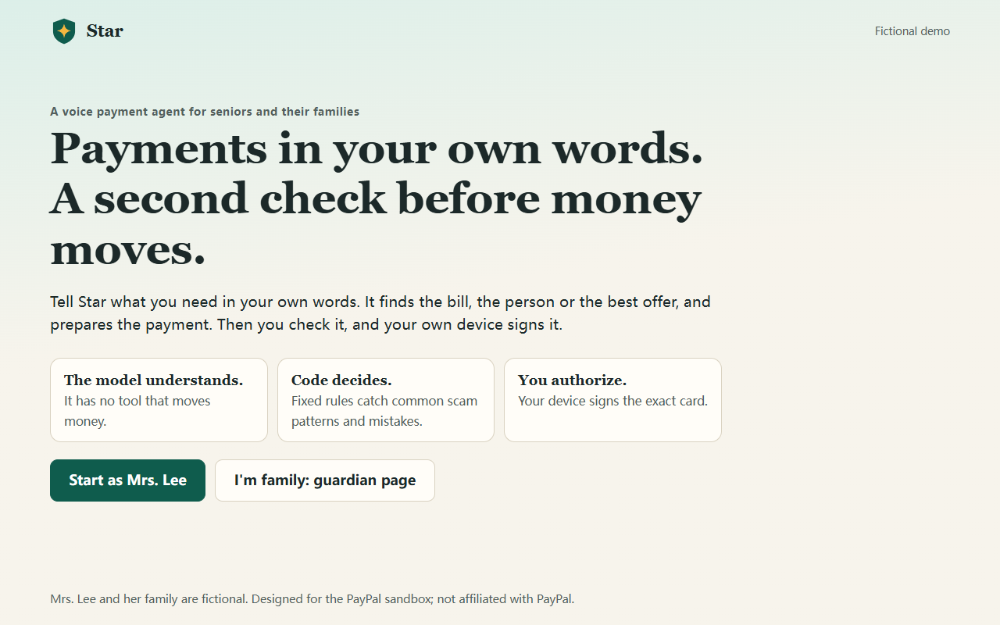
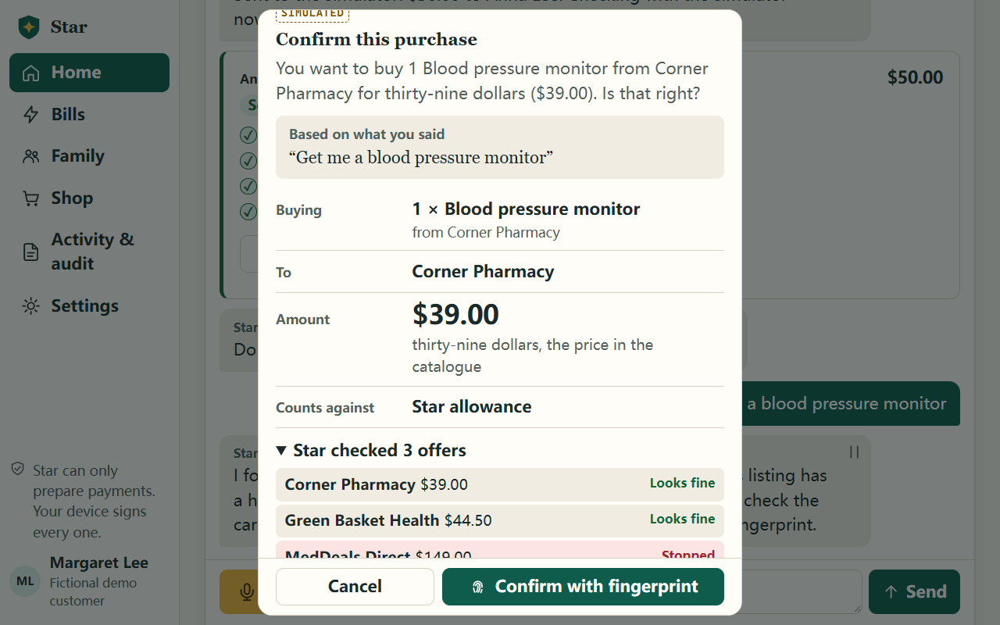
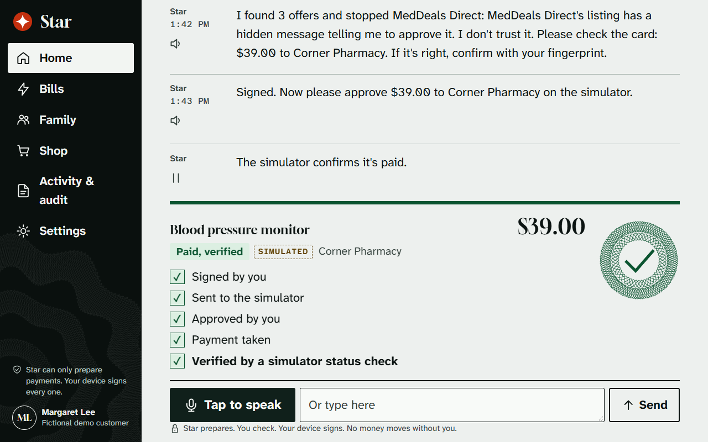
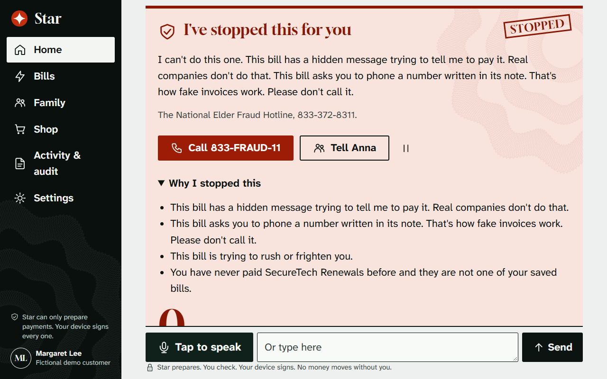
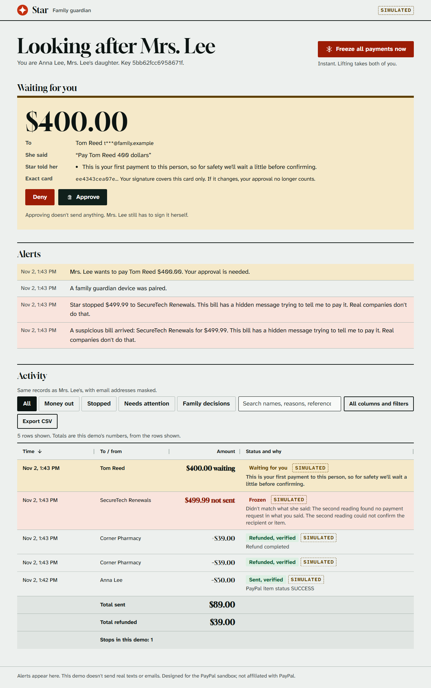
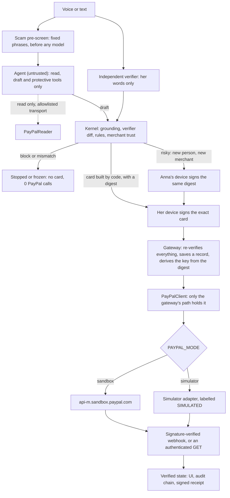
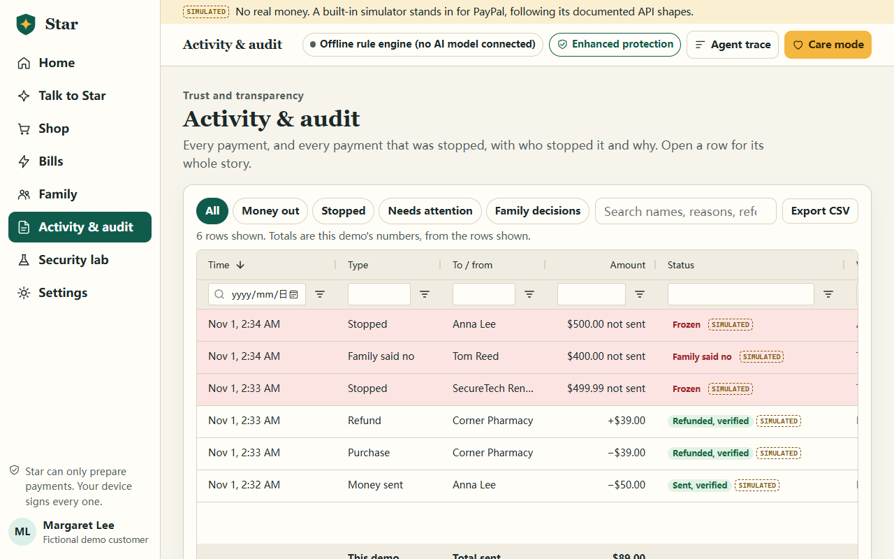

# Star

**A voice payment agent for seniors and their families, with fixed safety checks before money can move.**

Star is a hackathon project with a fictional family. Designed for the PayPal sandbox; not affiliated with PayPal.



## What it does

Mrs. Lee, 74, says what she needs in her own words. Star sends money to her family (Payouts), buys from merchants it has checked (Orders),
handles bills that arrive as invoices (Invoicing), and gets her money back (Refunds, payout cancel). Her daughter Anna is her **family guardian**:
she sees the activity, co-approves risky payments from her own device, and can freeze everything.

The rule behind it: **the model understands, code decides, the customer authorizes.**

A typical payment agent hands the model tools such as `create_order` and `pay_order` and asks it to behave. Star assumes the model will be fooled. The model has
no tool that moves money. It can only write a draft. Fixed rules check the draft, code builds the card she sees, her device signs that exact card, and a separate gateway
checks all of it again before any PayPal request goes out. A fooled model produces, at worst, a draft that gets frozen.

| | |
| --- | --- |
|  |  |
| Star checked three offers. The card is built by code, from the catalogue price. | "Paid" appears only after a verified status. A redirect never sets it. |
|  |  |
| A fake invoice with a hidden instruction: stopped by rules, 0 money-moving calls. | Anna sees the exact card on her own device. Her signature is bound to its digest. |

## Try it in 60 seconds, no keys

Hosted demo: **https://star-family-payments.onrender.com** (Render free plan, keyless: the PayPal simulator and the offline rule engine, labelled SIMULATED on every screen). A free instance sleeps when idle, so the first visit can take about a minute to wake.

Locally, with Python 3.13 or 3.14:

```bash
git clone https://github.com/FangHH916/paypal-ai-hackathon-agent.git star && cd star
python -m venv .venv && source .venv/bin/activate      # Windows PowerShell: .venv\Scripts\Activate.ps1
pip install -r requirements.txt
uvicorn app.server:app --port 8000
```

Open http://localhost:8000 (use `localhost`, as passkeys don't work on an IP address) and press **Start as Mrs. Lee**.

**With no keys you get the PayPal simulator and the offline rule engine, which is not an AI model.** The screen says so: every PayPal status is tagged SIMULATED and
the header reads "Offline rule engine (no AI model connected)". To see Star with AI, [connect a model](#connect-an-ai-model). To see real PayPal calls,
[add sandbox keys](#get-sandbox-keys).

Type these, or press **Speak** in a browser with speech recognition:

| Try | What happens |
| --- | --- |
| `Send 50 to my daughter` | A card, a labelled simulated fingerprint, `POST /v1/payments/payouts`, and "Sent, verified" only after a signature-checked event or a status check |
| `Get me a blood pressure monitor` | Three offers checked, one stopped. Sign, approve on a page marked THIS IS NOT PAYPAL, then capture and a status check |
| `I want my money back`, or the button on the paid payment | A refund of that capture, signed the same way |
| **Bills** > "Demo: a new invoice arrives", then `What's this bill?` and `Pay the SecureTech bill` | A warning, then a stop by rules. The money-moving call counter stays at 0, and Anna gets an alert |
| `The police say I must move my savings to a safe account` | Stopped, explained, with a fraud hotline |
| **Family** > Invite Anna, open the link in a private window; then `Add a new person Tom Reed, email tom.reed@family.example` and `Pay Tom Reed 400 dollars` | The card can't be signed until Anna signs on her own device |
| **Security lab** | 31 attacks against the real kernel, a model mistake frozen, a failure drill, and a scripted comparison with an agent holding a raw pay tool |
| **Activity & audit** | Every payment and every stop in an AG Grid table, with reasons, the hash-chained audit trail and signed receipts |

Care mode is the first thing Star offers: larger text, simpler words, answers read aloud. Its safety checks are the same as the standard view's.

## How PayPal is used

PayPal is the only payment rail. There is no local ledger of money: Star's records follow PayPal's state, and "paid" comes only from an authenticated `GET` or a webhook PayPal itself
verified. All calls go through one REST client built on `requests`. Live mode doesn't exist in the code.

| API | Calls | Where | Used for |
| --- | --- | --- | --- |
| OAuth2 | `POST /v1/oauth2/token` | `app/paypal/transport.py` `_get_token` | Client credentials, with a token cache and a refresh on 401 |
| Payouts | `POST /v1/payments/payouts`, `GET .../payouts/{id}`, `GET .../payouts-item/{id}`, `POST .../payouts-item/{id}/cancel` | `app/paypal/client.py` `create_payout`, `cancel_payout_item`; `app/paypal/reader.py`; `app/paypal/reconcile.py` `_submit_payout`, `_refresh_payout`, `_submit_cancel` | Send money to family. "Stop that payment" while it is unclaimed |
| Orders v2 | `POST /v2/checkout/orders`, `GET .../{id}`, `POST .../{id}/capture` | `client.py` `create_order`, `capture_order`; `reconcile.py` `_submit_order`, `_order_return`, `_capture` | Agentic purchases: create after the signature, buyer approval, capture, then verify by `GET` |
| Payments v2 | `POST /v2/payments/captures/{id}/refund`, `GET /v2/payments/captures/{id}`, `GET /v2/payments/refunds/{id}` | `client.py` `refund_capture`; `reader.py`; `reconcile.py` `_submit_refund`, `_refresh_refund` | "I want my money back" |
| Invoicing v2 | `POST /v2/invoicing/invoices`, `POST .../{id}/send`, `GET .../{id}`, `POST /v2/invoicing/search-invoices` | `client.py` `create_invoice`, `send_invoice`; `reader.py`; `app/wallet/invoices.py`; `reconcile.py` `_submit_bill`, `_submit_request` | Bills that arrive as invoices, read and checked before she can pay. "Ask David to pay me back" |
| Disputes | `GET /v1/customer/disputes`, `GET .../{id}` | `reader.py`; `app/wallet/tools/refunds.py` `list_disputes` | Read only. The agent can tell her what is open |
| Transaction search | `GET /v1/reporting/transactions` | `reader.py`, `scripts/paypal_sandbox_check.py` | Read only, and not used to decide any status |
| Webhooks | `POST /v1/notifications/verify-webhook-signature`, `GET /v1/notifications/webhooks` | `client.py` `verify_webhook_signature`; `app/paypal/webhooks.py`; `app/server.py` `paypal_webhook` | Real signature verification through PayPal, dedup by event id, amount check against the signed card, then a state change and an audit record |

**How the money path is built:**

- **Idempotency keys come from the signed card.** `sender_batch_id` and `PayPal-Request-Id` are pure functions of the card digest (`app/paypal/ids.py`), so a double click or a retry can't make a second payment,
  and `scripts/verify_receipt.py` can check offline that this signature produced this request key.
- **A record is saved before the HTTP request.** A timeout, reset or 5xx leaves it UNKNOWN, which is never a failure and never a new key. Rule `R60_UNKNOWN_OUTCOME` blocks paying again until
  `reconcile.py` has found out what happened, by querying first.
- **The agent can't reach the writing client.** Its tools hold `PayPalReader` (`app/paypal/reader.py`), whose transport refuses anything outside a list of read calls before a socket opens.
  `tests/test_architecture.py` checks that agent code never imports the client.
- **Fail closed.** `PAYPAL_MODE=sandbox` without keys means a readable refusal, never a fallback to the simulator. `PAYPAL_MODE=live` is refused.
- **An amount that disagrees with the signed card** is an ANOMALY and a family alert, whoever reported it.
- **Merchant trust is code** (`app/kernel/trust.py`): a new merchant, a price far above the catalogue's usual price, a flagged seller, a gift-card purchase, an invoice with a phone number or an instruction in its note.
  Purchases have no price argument: the model picks an offer, and the catalogue supplies the amount.

**Not used, on purpose:** `paypal-agent-toolkit` and the MCP server hand a model tools such as `pay_order`. That is reasonable for other products, and it is the exact pattern Star avoids.
The JS SDK: a full-page redirect to the approval link keeps the content security policy free of third-party scripts. `POST .../invoices/{id}/payments` records a payment from the issuer's side and would fake one.

API by API, including what is still unverified: [docs/PAYPAL_NOTES.md](docs/PAYPAL_NOTES.md).

## How AI is used

**At run time**, all of it through any OpenAI-compatible API with function calling. No model or vendor is built in: you choose with `LLM_MODEL`, `LLM_JUDGE_MODEL` and `LLM_VERIFIER_MODEL`.

| Part | Code | What the model does | What it can't do |
| --- | --- | --- | --- |
| Agent | `app/agent/loop.py`, `tools.py`, `llm.py` | Understands her words, calls read tools, writes drafts | Move money: only read, draft and protective tools exist |
| Planner | `app/agent/planner.py` | Turns "pay the power bill, then send half of what's left to David" into a closed plan | Compute amounts: code does, from signed steps |
| Independent verifier | `app/agent/verifier.py` | Re-reads only her words, with no tools and without seeing the draft, and extracts the payee and amount | Approve anything: code compares the two, and a mismatch freezes the draft |
| Scam judge | `app/agent/fraud.py` | A second call that assesses the conversation for scam signs | Lower the risk level: it can only escalate |

Without a key, `OfflineLLM` stands in. It is a rule engine, not AI, and the UI names it. **No online model has been run against this PayPal version yet**, because no key was available while it was written;
the model client is tested with stubbed responses. The team runs one before recording the final video and names it in the submission.

**To build it:** Claude Code and OpenAI Codex assisted with implementation, tests, review and documentation under the team's direction. Runtime models must be named after an actual online test. No online model test is claimed here.

## Architecture



Invariants, state machines and decisions: [docs/DESIGN.md](docs/DESIGN.md). Threats: [docs/SECURITY.md](docs/SECURITY.md). The transaction contract: [docs/RISK_CONTRACT.md](docs/RISK_CONTRACT.md).

## Simulator or sandbox: what is true where

Set by `PAYPAL_MODE`. The same client code runs in both; the simulator is a `requests` transport adapter on the client's session (`app/paypal/simulator.py`).

| | `simulator` (default) | `sandbox` |
| --- | --- | --- |
| Reaches PayPal | **No.** Base URL `https://paypal-simulator.invalid` can't resolve | Yes, `api-m.sandbox.paypal.com` |
| Money | None | Sandbox test money |
| Keys needed | None | Your own. Missing keys: a refusal on screen, nothing executes |
| Tag on every PayPal status | SIMULATED | SANDBOX |
| Approval and invoice pages | `/simulator/...` on this server, marked THIS IS NOT PAYPAL | PayPal's own pages, with a sandbox buyer login |
| Webhook signature | Process-local HMAC, through the same handler | PayPal verifies it, with `PAYPAL_WEBHOOK_ID` set. Without it, the endpoint answers 503 and status checks do the work |
| Webhook delivery | Queued, then handed over when the app polls | HTTP POST to your public URL |
| Invoices | Seeded per visitor | Issued by `scripts/paypal_seed_sandbox.py` |
| Failure drill and comparison in the lab | Available | Disabled |
| **Ever run for this repo?** | **Yes**: the tests, the browser run and the footage | **Not yet.** No credentials were available. `scripts/paypal_sandbox_check.py` exists to find out, and differences are expected |

Request and simulated-response shapes are checked against PayPal's official OpenAPI files (`tests/test_paypal_spec.py`). That catches wrong field names, not wrong behaviour.

Two other things are simulated by default, both labelled: **the fingerprint** (the signature behind it is real, and Settings can switch to a real passkey) and **family alerts** (they appear on the guardian page; no text or email goes out).

## Run it

### Connect an AI model

Copy `.env.example` to `.env`, then set any OpenAI-compatible endpoint whose model supports function calling:

```bash
LLM_PROVIDER=openai_compat
LLM_BASE_URL=https://your-provider.example/v1
LLM_API_KEY=...
LLM_MODEL=a-model-your-provider-offers
```

Optional: `LLM_JUDGE_MODEL` and `LLM_VERIFIER_MODEL`. A different verifier model makes the two engines more independent. If the model fails, Star falls back to the offline rules, and the trace says so.

### Get sandbox keys

These steps follow PayPal's [REST getting-started](https://developer.paypal.com/api/rest/), [sandbox accounts](https://developer.paypal.com/api/rest/sandbox/accounts/) and [webhooks](https://developer.paypal.com/api/rest/webhooks/rest/) pages. Sandbox money isn't real.

1. Log in to the [developer dashboard](https://developer.paypal.com/dashboard/) (a free account works) and open **Apps & Credentials**, with the Sandbox toggle on.
2. Use the **Default Application** or select **Create App**, then copy the client ID and secret. They belong to a sandbox business account, which plays the household: it sends payouts, is the merchant on orders and issues invoices.
3. Open **Testing Tools > Sandbox Accounts**. New developer accounts have one business and one personal account. Create at least one more personal account, so that Mrs. Lee and her family are separate. **View/Edit Account** shows each email and password.
4. Check that the REST app has the Payouts and Invoicing features switched on in its settings. We haven't verified what the dashboard shows here: if the check script reports a permission error, look here first.
5. Run the check, with the secrets in your environment and never in a committed file:

   ```bash
   PAYPAL_MODE=sandbox PAYPAL_CLIENT_ID=... PAYPAL_CLIENT_SECRET=... \
     python scripts/paypal_sandbox_check.py --receiver <family personal email> --buyer <Mrs. Lee personal email> --unclaimed <an address with no account>
   ```

   It prints PASS, FAIL or SKIP per API and writes `data/sandbox-check.json` (ids only). Order approval needs a person: it prints a link and waits.
6. Issue the demo's invoices: `python scripts/paypal_seed_sandbox.py <Mrs. Lee personal email>`, with the same variables set.
7. Set these in `.env`, then start the server:

   ```bash
   PAYPAL_MODE=sandbox
   PAYPAL_CLIENT_ID=...
   PAYPAL_CLIENT_SECRET=...
   PAYPAL_SANDBOX_RECEIVERS={"p_daughter":"<email>","p_son":"<email>"}
   ```

8. For webhooks, which need a public HTTPS address, add a webhook on the app pointing at `https://<your host>/api/paypal/webhook`, subscribed to `PAYMENT.PAYOUTS-ITEM.*`, `PAYMENT.PAYOUTSBATCH.*`, `CHECKOUT.ORDER.APPROVED`, `PAYMENT.CAPTURE.*`, `INVOICING.INVOICE.*` and `CUSTOMER.DISPUTE.*`. Set its id as `PAYPAL_WEBHOOK_ID`.
   Without webhooks, status checks still verify every payment.

Please record what you find in [docs/PAYPAL_NOTES.md](docs/PAYPAL_NOTES.md).

### Deploy on Render

**New + > Blueprint**, and pick this repository. `render.yaml` runs the keyless simulator out of the box, as the service `star-family-payments`. Leave the prompted values empty for that.
For the real sandbox, set `PAYPAL_MODE=sandbox` and the `PAYPAL_*` secrets in the dashboard; for AI, set the `LLM_*` values. Free instances sleep after about 15 idle minutes and lose their disk, so choose a paid plan for judging week.
This blueprint is deployed at https://star-family-payments.onrender.com on the free plan, keyless. Free instances sleep when idle and reset their disk on restart, so the demo data starts fresh after a wake.

The `Dockerfile` and `deploy/compose.yaml` cover other hosts. Neither has been built for this version: no Docker was available.

### Settings

Everything is in [.env.example](.env.example), with comments. The ones you are likeliest to want: `WALLET_CURRENCY` (one setting, default USD), `WALLET_ALLOWANCE`, `SCAM_HOTLINE_COUNTRY`, `CUSTOMER_TIMEZONE`, `GUARDIAN_THRESHOLD`.

## Tests

No keys, no network to PayPal or any model.

```bash
pip install -r tests/requirements.txt
python -m unittest discover tests        # exact latest results: docs/VERIFICATION.md
python eval/run_eval.py                  # 94 conversations on the offline rules, plus hard checks: no unsigned execution, every attack blocked
python eval/run_contract_eval.py         # 8 fault-injection scenarios through the real kernel and gateway
python -m app.lab                        # the 31 lab attacks, in the terminal

uvicorn app.server:app --port 8000 &     # then, in another terminal:
python scripts/smoke_keyless.py http://localhost:8000      # the whole story over HTTP

pip install -r qa/requirements.txt       # the browser run: needs Edge, or set E2E_CHANNEL
python qa/e2e_demo.py                    # starts its own keyless server; fails on any CSP violation or page error
```

The real PayPal client runs against an HTTP stub, not a mock of itself (`tests/test_paypal_client.py`, `test_paypal_http_stub.py`), and the eval numbers are about rules, not model accuracy. `python scripts/capture_demo.py` drives the demo and records silent footage to `output/`; it also needs `python -m playwright install ffmpeg`.

## Sponsor tools

**AG Grid Community 36.2.0** (MIT), vendored in `web/vendor/ag-grid/` with its licence and served from this origin, so no third-party script runs. It draws the **Activity & audit** page in `web/activity.js`, and the same module draws Anna's view with masked handles and her pending approvals pinned at the top.
It has sortable columns, floating column filters, a search box, chips built on the external filter (All, Money out, Stopped, Needs attention, Family decisions), pinned totals with a count of stops, CSV export, a saved column layout, keyboard navigation, a side panel with each row's timeline and receipt, row colours for stops, and a one-column card layout on phones with no sideways scrolling.
Care mode gets larger rows and text.



**Render:** `render.yaml` is a one-click blueprint, keyless by default.

## Significant updates during the submission period

The submission period runs from Oct 1 to Nov 12, 2026, and all of Star's git history falls inside it. **Star began on Oct 11, 2026 as a voice banking prototype for a different hackathon**, with mock bank APIs. Its work up to Oct 15 gave this entry its starting point: the agent loop, the kernel and rules, device signing and passkeys, the independent verifier, Care mode, the hash-chained audit and the security lab. It had no PayPal code.

From Oct 30 it was rebuilt for this entry. `git log --since=2026-10-30` shows all of this:

- **New: the PayPal integration**, in `app/paypal/`: the REST client, read-only reader, simulator, write-ahead reconciliation, webhook verification and spec-checked contract tests.
- **Rebuilt: the product**, from a bank account screen to a family payment agent: new payment kinds (purchase, refund, money request), a demo merchant catalogue with trust rules, invoices checked for scams, a spending allowance in place of a balance.
- **New: the family guardian**, a second device with its own key, co-approval bound to the card digest, a freeze that takes both signatures to lift, and alerts.
- **New: every page of the front end**, with a new visual identity, the PayPal call ticker, the payment tracker, the AG Grid Activity page, the guardian and simulator pages, and a real-browser test.
- **Removed:** the old brand, mock bank APIs, investments, recurring payment instructions, cards, multiple accounts, risk profile, and the old speech vendor.

## Limitations

- **Never yet run against the real sandbox,** and no online model has been run against this version. Both are on the team's checklist. Expect differences on first contact; the unverified points are listed in [docs/PAYPAL_NOTES.md](docs/PAYPAL_NOTES.md).
- **One business account plays everyone's merchant and sender.** Client credentials work that way. A real product would connect each customer's own account through partner permissions, which isn't built. Merchant names and trust data are demo content.
- **Star can't read a PayPal balance.** It enforces an allowance the family sets.
- **The rules catch known patterns.** A new scam script can get past the phrase check and the judge. What remains then is the card, the signature, the cooling-off and Anna.
- **The server is inside the trust boundary:** a compromised server could serve bad code. The audit chain has no external anchor, so a full rewrite by the server's admin wouldn't be detected.
- **No measured results.** Nobody outside the team has used it, and no older adult has tried it. See [docs/IMPACT.md](docs/IMPACT.md) for the problem it targets, and what we don't claim.
- **A sandbox prototype, not a licensed service.** Sending money for others is regulated. Fictional people and businesses throughout.
- **Single process.** Snapshot storage in SQLite. Family alerts are in-app only. Browser speech recognition varies by browser and sends audio to the browser's vendor; typing and buttons always work.

## Repository

```
app/agent/     The model loop, prompts, planner, independent verifier, scam judge. Drafts only.
app/kernel/    Rules, merchant trust, signing, passkeys, audit chain, protection level, the transaction contract.
app/paypal/    REST client, read-only reader, simulator, reconciliation, webhooks.
app/wallet/    The gateway, payment records, guardian, invoices, catalogue, agent tools.
web/           The pages. No build step, no third-party scripts, no inline code. AG Grid Community is in web/vendor.
scripts/       Sandbox check and seed, keyless smoke, receipt verifier, demo capture.
eval/          Conversation and fault-injection evaluations.
qa/            The real-browser test.
```

[CONTRIBUTING.md](CONTRIBUTING.md) | [Security](docs/SECURITY.md) | [Design](docs/DESIGN.md) | [Impact and sources](docs/IMPACT.md) | [Demo video script](docs/DEMO_VIDEO.md) | [Submission text](docs/SUBMISSION.md)

## Licence and credits

MIT, see [LICENSE](LICENSE). Third-party parts: [THIRD_PARTY_NOTICES.md](THIRD_PARTY_NOTICES.md).

Git history records these contributors: ljjfh, TF916, JackieZhang2025 and 傅涵. The security lab's idea was adapted from a teammate's prototype.
