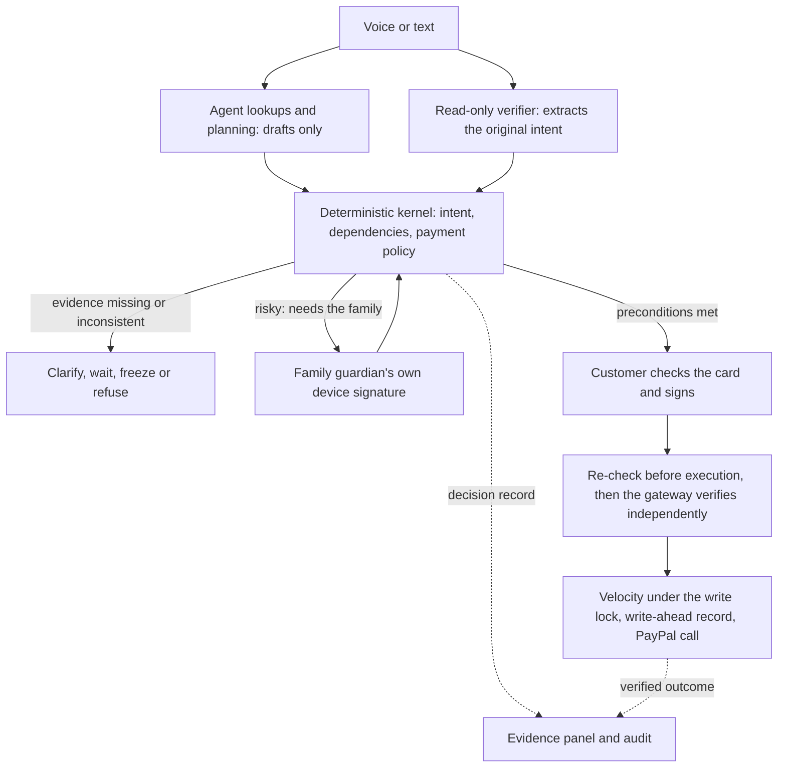

# Star: an executable transaction contract

AI can propose a payment. Whether it goes ahead depends on intent, plan dependencies, what was authorised and the conditions at execution, all checked by code, each leaving evidence that can be reviewed.
This is a deterministic control framework on a simulator or the PayPal sandbox. It isn't a trained risk model, and it doesn't claim absolute security.



## Four principles, and the evidence for each

| Principle | Check | Shown and tested by |
| --- | --- | --- |
| Faithful to what the customer said | Amount and payee are extracted independently. A mismatch freezes the draft | Her words, the AI draft and the verifier's result side by side |
| The plan's dependencies hold | Earlier draft ids are bound into the signed card. The kernel and gateway check this customer's verified records | A step can't be signed until the earlier one has finished; another customer's record doesn't count |
| What was approved is what runs | The device signature is bound to the card digest. The gateway verifies it independently and refuses replays | Changing the amount, payee or a dependency id invalidates the signature |
| Still safe at execution | Checks run again before execution, velocity is enforced under the lock, and a guardian approval is needed where the rules require it | An allowance change after signing, a full velocity window or a missing approval all stop it |

`app/kernel/contract.py` produces one decision record: policy version, stage, action, checks, reason codes, required evidence, verifier mode and guardian evidence. HTTP refusals also record a reason.

The dependency ids belong to the customer's signed card. The risk explanation is a server observation, not something the customer signed. The receipt's plain SHA-256 isn't independent proof of a third party's decision: the server is still inside the trust boundary.

## Risks and what happens

- **Intent mismatch:** frozen, and the draft can't be signed.
- **Verification missing:** waits, and can't be authorised.
- **Dependency not executed:** refused, and the request is confirmed again.
- **Velocity window full,** by default 5 in 10 minutes (`RULE_VELOCITY_MAX`, `RULE_VELOCITY_WINDOW_MIN`): new payments are refused until the window frees up. It is checked again under the write lock, and the count persists. Idempotent retries don't use up the count, and neither do refunds or money requests.
- **Family guardian required:** a payment to **someone never paid before** above `GUARDIAN_THRESHOLD`, someone she added herself building up to it (over the threshold in total within 30 days, or above the most she has ever sent them), a merchant or bill check that asks for the family, or scam signs earlier in the conversation that weren't stopped outright. Refunds and money requests don't need it. Impersonation scams nearly always use a new payee, so this is where approval matters most.
  Not needed: bills and family or payees paid before, though cooling-off, verify questions and signatures still apply. Hard limits always apply.
- **Cooling-off, the extra question, the guardian and the device signature** are separate conditions and can't stand in for each other.
- **Invalid signature, a replay, or risk raised before execution:** refused.

## Trying it

```bash
pip install -r tests/requirements.txt
python -m app.serve
```

The customer uses the chat and card at localhost:8000. The safety evidence ("How Star checked this") is collapsed by default, to keep her path simple. **Security lab > Run risk demonstration** runs the whole isolated demonstration, with no online model.

To show the family guardian:

1. On the Family page, press Invite Anna and sign. You get a one-time link; open it in **another browser profile or a private window** and pair.
2. Add someone never paid before (`Add a new person Tom Reed, email tom.reed@family.example`, and sign), then say `Pay Tom Reed 400 dollars`. The card waits for the family.
3. On her page, Anna checks the words, amount, payee and card digest, and approves or denies with her own device's key.
4. After approval the customer's card updates by itself. She still has to sign it herself before anything runs.

The approval is a signature over this card's digest, so it lapses if the card changes, and the gateway verifies it again at execution. The guardian can't start a payment or unlock one the rules blocked.
An approval is bound to the customer, session, draft, digest and policy version. It is revoked on cancel and removed on success. A restart loses pending approvals, and the payment has to be started again.

This models a second person with their own device key. It isn't a hardware token, an independent channel or a call-back. Deployments should use HTTPS. KYC and real onboarding are out of scope.

## A five-minute walkthrough

1. Explain the four principles: AI only proposes, deterministic code decides whether it continues.
2. Send $50 normally. The customer signs; show the tracker going from waiting to verified, and download the receipt.
3. Security lab > Run risk demonstration. Open the wrong amount, wrong payee and unfinished-step cases, and point to the check that failed and to 0 money-moving PayPal calls.
4. Show the amount altered after signing, and the allowance changed: earlier authorisation doesn't carry a wrong condition through.
5. Show a missing guardian approval and a full velocity window, then explain the comparison table and what it doesn't measure.

The eight scenarios really run the kernel, device signatures and gateway, in a fresh simulator. To isolate the missing-approval condition, that one case's fixture clock has passed the cooling-off period; the customer service has no way to skip cooling-off.
The allowance case changes the allowance from outside the fixture, and the report separates that from what the payment itself used.

## Saying the comparison accurately

The A/B/C table in the UI is a **replay of gate results for five fixed candidate payments**:

- A: signature prerequisites only, with no payment policy, intent or dependency checks.
- B: adds payment policy hard limits. Confirmation questions are assumed answered yes, so they don't count as stops.
- C: adds the intent and dependency gates.

It records whether each candidate would reach authorisation. No weakened system ran, and no real user was asked to approve a wrong payment.
The set has four faults and one normal control, so the results aren't model accuracy, population risk or a false-alarm rate. The eight scenarios and the five replays are different kinds of evidence and don't add up to a count of safety cases.
The offline verifier shares its parser with the offline agent, and the UI says so. Comparing real models, friction for normal users, accents and latency all need separate study.

## Rerun it

```bash
python -m unittest discover tests
python eval/run_eval.py
python eval/run_contract_eval.py
```

The last one writes `eval/contract-report.json`, and exits nonzero if a scenario isn't as expected. The browser test is `python qa/e2e_demo.py`, which runs its own server and temporary data and calls no model.
